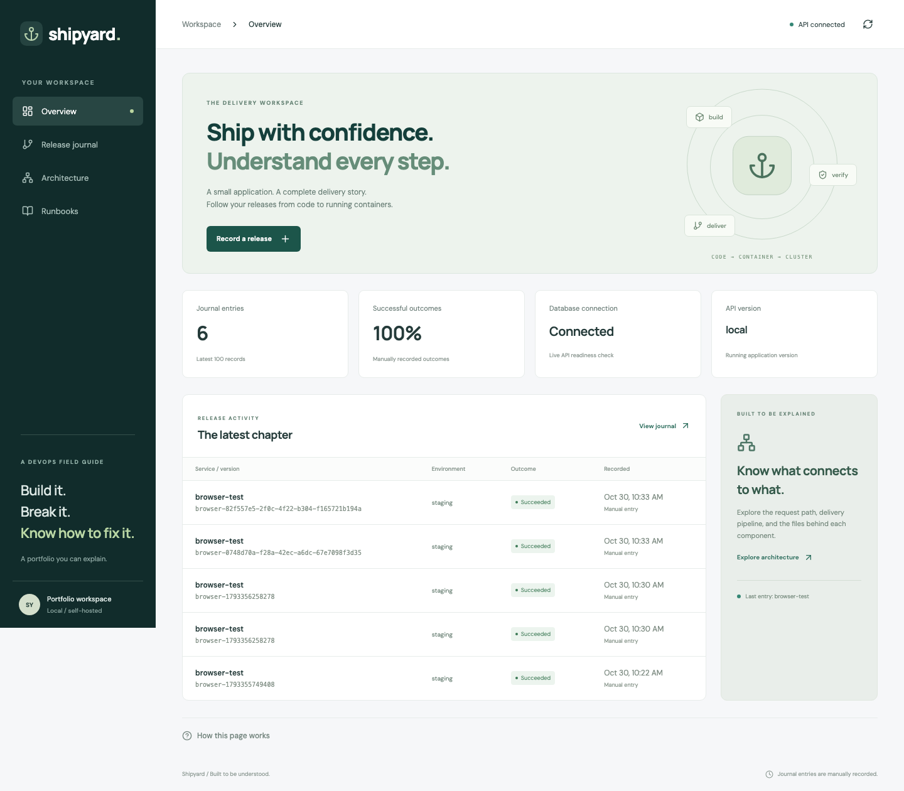
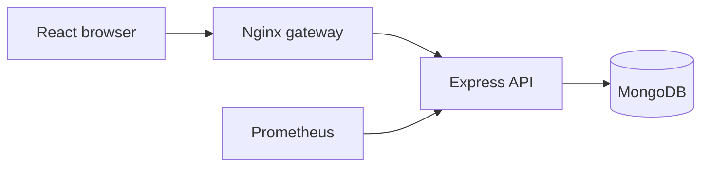

# Shipyard · DevSecOps portfolio

[](https://github.com/KhyzerRiaz24/shipyard-devsecops/actions/workflows/check-and-deploy.yml)

A release journal built to explain the complete delivery path: browser → gateway → API → database, with tests, containers, security checks, infrastructure code and recovery runbooks.

**[Try the free interactive demo](https://khyzerriaz24.github.io/shipyard-devsecops/)** · **[Read the architecture](docs/architecture.md)** · **[Follow the file guide](docs/file-guide.md)**



## What the live demo does

The public GitHub Pages site lets visitors create, search and filter demonstration release records. Records stay in that visitor's browser. The banner and storage labels make this explicit: the free site does not run Express, MongoDB, Jenkins or an AWS cluster.

The same source also runs as a real three-tier application using Docker Compose. That version uses authenticated writes and persistent MongoDB storage. AWS/EKS deployment configuration is included for a future cloud deployment; no AWS resources are needed for the public showcase.

## What this project demonstrates

- **Application delivery:** React, an Nginx gateway, Express APIs and MongoDB persistence.
- **Security:** validated input, token-protected writes, least-privilege database access, non-root application containers, bounded request bodies and credential checks.
- **Reliability:** separate liveness/readiness checks, graceful shutdown, persistence tests, isolated backup restoration and documented failure exercises.
- **Automation:** GitHub Actions runs tests and checks before publishing the free demo. A separate Jenkins pipeline defines SonarQube and image gates plus ECR publishing for the AWS path.
- **Infrastructure:** Terraform defines AWS networking, EKS Auto Mode and ECR; Kustomize and Argo CD define the deployment path, availability settings and monitoring.
- **Explainability:** each page includes a “How this page works” panel. Source comments explain purpose, boundaries and connections.



The diagram describes the full Docker/cloud application. The free public demo uses the separate, labelled browser-storage adapter.

## Run the real application locally

Requirements: Node 22.12+ and Docker Desktop with Compose. If you use nvm, run `nvm use` first.

```bash
 git clone https://github.com/KhyzerRiaz24/shipyard-devsecops.git
 cd shipyard-devsecops
 node scripts/setup.mjs
 docker compose up --build -d
 docker compose ps
```

Open **http://localhost:8080**. To record a release, use the `WRITE_TOKEN` from the generated local `.env` file. Open it privately in your editor; do not paste it into chat or commit it. The setup script generates credentials once and preserves an existing `.env`.

MongoDB initializes its application account only on the first startup of an empty data volume. Changing `.env` is not a database password-rotation mechanism.

Stop the app while preserving the journal: `docker compose down`.

## Checks and demo development

```bash
npm ci
npm run check
npm run build:demo
npx playwright install chromium
npm run test:demo
```

`npm run check` exercises API behaviour, a real temporary MongoDB process, React interactions, the production build, YAML references and offline credential patterns. The first database integration run may download a test MongoDB binary.

After Compose is healthy, `npm run test:browser` tests the real three-tier application in desktop and mobile browsers. `npm run test:demo` tests the separate static demo and asserts that it makes no backend API requests.

The [verification record](docs/verification.md) identifies the checks actually completed. Coverage and local load measurements are supporting evidence, not production-availability claims.

## Read the project

1. [File guide](docs/file-guide.md) — purpose and connections of the main files.
2. [Architecture](docs/architecture.md) — request flow, delivery flow and tradeoffs.
3. [Development](docs/development.md) — local work and verification commands.
4. [Free demo](docs/free-demo.md) — GitHub Pages, browser storage and deployment boundaries.
5. [Pipeline](docs/pipeline.md) — GitHub Actions plus the separate Jenkins/AWS path.
6. [AWS guide](docs/aws.md) — optional paid infrastructure deployment.
7. [Runbooks](docs/runbooks.md) — backup, restoration, failure exercises and teardown.
8. [Portfolio evidence](docs/portfolio.md) — demonstrations and interview questions.

## Scope and decisions

The application is deliberately small so the delivery and operational decisions remain understandable. The full application uses a shared write token rather than a complete multiuser identity system. MongoDB has one member; the supplied infrastructure is not a claim of database high availability. Journal outcomes are manually recorded observations, not automatic proof that a pipeline passed.

Inspired by [NotHarshhaa’s Project 40](https://github.com/NotHarshhaa/DevOps-Projects/tree/master/DevOps-Project-40). This repository is an original implementation with a different application and newly written code, infrastructure and documentation.
