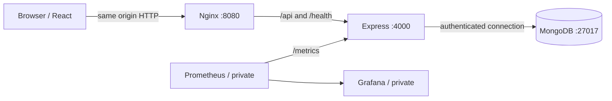
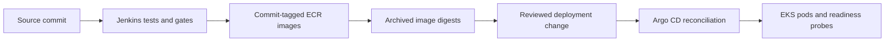

# How the pieces connect

## Free public demo

The GitHub Pages deployment is a separate browser-storage demonstration. `mode.js` selects it only for Vite demo builds. `api.js` delegates to `demo.js`; no API/database health or deployment result is fabricated. The following diagrams describe the full Docker/AWS application, which remains runnable locally.

## Application request path

1. `apps/web/index.html` loads `src/main.jsx`, which mounts `App.jsx`.
2. `App.jsx` selects a page from the URL hash and loads journal/system data through `useWorkspace.js` and `api.js`.
3. Development uses Vite’s proxy. Containers use `nginx.conf`. Both forward `/api` without changing the path.
4. `apps/api/src/app.js` validates and authenticates writes. It uses `store.js` to read/write the `shipyard.releases` collection.
5. Docker Compose DNS and Kubernetes Services both supply the internal names `api` and `mongo`. The browser never needs either internal hostname.

`POST /api/releases` accepts service, version, environment, status and notes. The API assigns ID, timestamp and `source: manual`. It refuses unknown fields and invalid values. Reads are public by design; use nonconfidential portfolio data.

`/health/live` checks the running process. `/health/ready` pings MongoDB. Database failure removes API pods from ready endpoints without forcing a restart loop on otherwise healthy API processes.

## Delivery path

Jenkins publishes images only for `main`. It does not use an AWS administrator key or apply Kubernetes manifests. `scripts/promote.mjs` converts the published digests into an overlay change. A reviewer merges that change; Argo CD applies the desired state.

The Argo CD Application explicitly ignores the API Deployment replica count so its self-healing does not fight the horizontal autoscaler.

Argo CD reconciliation is not an automatic rollout undo mechanism. If a release fails readiness, the deployment stalls while old healthy replicas stay serving where capacity permits. Recover by reverting the promotion commit. `kubectl rollout undo` alone is temporary because Argo CD can reapply the broken desired state.

## Infrastructure boundaries and tradeoffs

Terraform creates infrastructure; Kustomize declares application resources; Argo CD reconciles the application. Keeping those concerns separate avoids a Terraform dependency cycle with a not-yet-created Kubernetes API.

EKS Auto Mode provides managed node provisioning, networking, block storage and ALB integration. The overlay uses the Auto Mode EBS provisioner. It deliberately does not mix in the standard EBS controller or standard AWS Load Balancer Controller installation instructions.

The app and web tiers use two replicas. MongoDB has **one member**, so this is not a highly available database. Its EBS volume belongs to one availability zone. A rescheduled pod can reattach the retained volume in that zone; a zone outage still requires a recovery design. The VPC uses one NAT gateway to reduce demo complexity, which is another availability tradeoff.

Application containers do not mount Kubernetes API credentials. The API uses a database-scoped account. Secrets stay outside Git. The public endpoint is optional and requires a real TLS certificate. Monitoring and administrative interfaces remain private.
